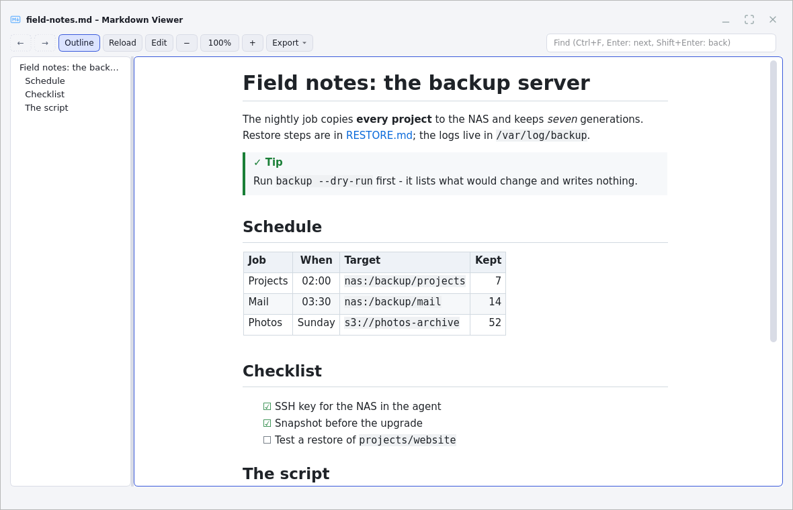
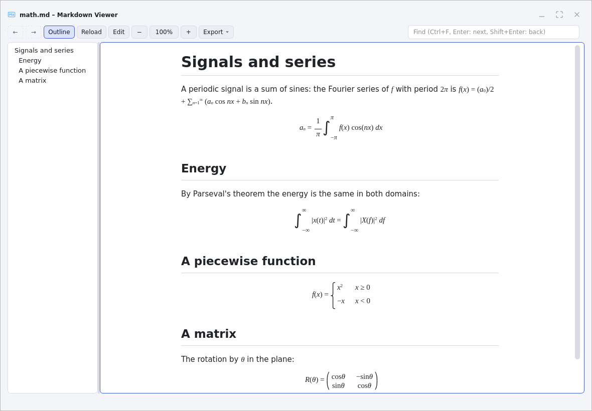

# axross-markdown

**axross's Markdown viewer on its own: GitHub Markdown with an outline, footnotes, highlighted code and local images - shown, never run.**

- **GitHub Markdown, complete** - CommonMark, tables, task lists, footnotes, alerts, definition lists, front matter.
- **Math without a browser** - `$...$` and `$$...$$`: fractions, integrals, sums, matrices and cases, drawn as text.
- **An outline beside the text** - every heading one click away; find (Ctrl+F) marks every match.
- **Highlighted code** - fenced blocks coloured by Pygments, in light and dark themes.
- **Local images** - the pictures beside the file, clickable when linked, bounded in size.
- **Shown, never run** - no scripts, styles, frames or forms; nothing is loaded from the network.
- **Links that ask first** - a Markdown link opens in the window; a web link only after a question showing its real address.
- **Edit with a live preview** - F4 opens an editor with the rendering beside the text, following the typing.
- **In the terminal too** - `axross-mdcat`: colours, box-drawn tables, links and pictures, no Qt needed.
- **Export** - the page as HTML with its images inside, as PDF, or printed.

## Contents

- **[Everything in detail: the extended README](https://github.com/c0decave/axross-markdown/blob/main/docs/README-extended.md)**
- [What changed: the CHANGELOG](https://github.com/c0decave/axross-markdown/blob/main/CHANGELOG.md)
- [Screenshots](#screenshots)
- [Install and run](#install-and-run)
- [Tests](#tests)
- [Licence](#licence)

## Screenshots



*The viewer: outline, alerts, tables, task lists.*

|  |  |
|:---:|:---:|
| *Dark theme: code coloured by Pygments, footnotes* | *Math: fractions, integrals, cases, matrices* |


*axross-mdcat: the same file in the terminal.*

## Install and run

```sh
pip install axross-markdown                    # or: pipx install axross-markdown
axross-markdown README.md docs/*.md            # a window for each
axross-mdcat README.md                         # in the terminal, in colour (no Qt needed)
axross-markdown --html notes.md > notes.html   # the page for a web browser
```

Or a one-file program without Python - Linux (also as an AppImage), macOS (also as a disk
image) and Windows - from the [latest release](https://github.com/c0decave/axross-markdown/releases/latest).

Every dependency is pinned and reviewed in `requirements.lock.txt`
([how to install exactly those](https://github.com/c0decave/axross-markdown/blob/main/docs/README-extended.md#the-exact-reviewed-dependencies)).

## Tests

```sh
python -m pytest tests
```

## Licence

Apache-2.0, as [axross](https://github.com/c0decave/axross): the same code, written out by axross's
`scripts/export_standalone.py`. Everything in detail: the [extended README](https://github.com/c0decave/axross-markdown/blob/main/docs/README-extended.md).
