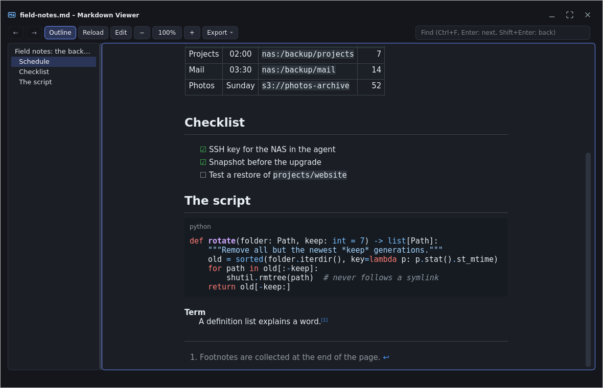
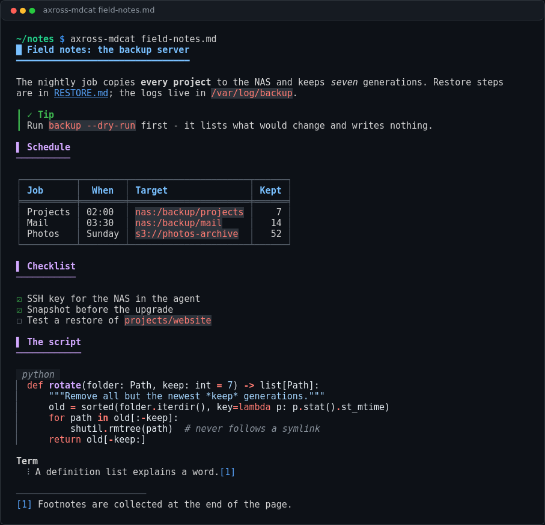

# axross-markdown

*GitHub Markdown in a window of its own - or in the terminal: read, never run.*


- **GitHub Markdown, complete** - CommonMark, tables, task lists, footnotes, alerts, definition lists, front matter.
- **Math without a browser** - `$...$` and `$$...$$`: fractions, integrals, sums, matrices and cases, drawn as text.
- **An outline beside the text** - every heading one click away; find (Ctrl+F) marks every match.
- **Twelve themes** - Light, Dark, Sepia, Solar, Arctic, Retro, Slate, Paper, High Contrast and more; code coloured by Pygments in each; every one WCAG AA.
- **Local images** - the pictures beside the file, clickable when linked, bounded in size.
- **Shown, never run** - no scripts, styles, frames or forms; nothing is loaded from the network.
- **Links that ask first** - a Markdown link opens in the window; a web link only after a question showing its real address.
- **Edit with a live preview** - F4 opens an editor with the rendering beside the text, following the typing.
- **In the terminal too** - `axross-mdcat`: colours, box-drawn tables, links and pictures, no Qt needed.
- **Export, and signed updates** - the page as HTML, PDF or printed; the one-file programs update themselves from signed releases.

## Contents

- **[Everything in detail: the extended README](https://github.com/c0decave/axross-markdown/blob/main/docs/README-extended.md)**
  - [The window: keys](https://github.com/c0decave/axross-markdown/blob/main/docs/README-extended.md#the-window-keys)
  - [Export and print](https://github.com/c0decave/axross-markdown/blob/main/docs/README-extended.md#export-and-print)
  - [Themes](https://github.com/c0decave/axross-markdown/blob/main/docs/README-extended.md#themes)
  - [In the terminal: axross-mdcat](https://github.com/c0decave/axross-markdown/blob/main/docs/README-extended.md#in-the-terminal-axross-mdcat)
  - [Updates](https://github.com/c0decave/axross-markdown/blob/main/docs/README-extended.md#updates)
  - [The security model](https://github.com/c0decave/axross-markdown/blob/main/docs/README-extended.md#the-security-model)
  - [Limits](https://github.com/c0decave/axross-markdown/blob/main/docs/README-extended.md#limits)
  - [Install options](https://github.com/c0decave/axross-markdown/blob/main/docs/README-extended.md#install-options)
- [What changed: the CHANGELOG](https://github.com/c0decave/axross-markdown/blob/main/CHANGELOG.md)
- [Screenshots](#screenshots)
- [Install and run](#install-and-run)
- [Tests](#tests)
- [Licence](#licence)

## Screenshots

|  |  |
|:---:|:---:|
| *Dark theme: code coloured by Pygments, footnotes* | *Math: fractions, integrals, cases, matrices* |



*axross-mdcat: the same file in the terminal.*

## Install and run

```sh
pip install axross-markdown                    # or: pipx install axross-markdown
axross-markdown README.md docs/*.md            # a window for each
axross-mdcat README.md                         # in the terminal, in colour (no Qt needed)
axross-markdown --html notes.md > notes.html   # the page for a web browser
```

Or a one-file program without Python - Linux (also as an AppImage), macOS (also as a disk
image) and Windows - from the [latest release](https://github.com/c0decave/axross-markdown/releases/latest);
it updates itself from the signed releases ([how](https://github.com/c0decave/axross-markdown/blob/main/docs/README-extended.md#updates)).

Every dependency is pinned and reviewed in `requirements.lock.txt`
([how to install exactly those](https://github.com/c0decave/axross-markdown/blob/main/docs/README-extended.md#the-exact-reviewed-dependencies)).

## Tests

```sh
python -m pytest tests
```

The tool's own tests from axross - 47 files, their imports renamed as the code's - and a test that the program starts and ends cleanly; Qt's offscreen platform, no display needed.

Tests that pass or fail by elapsed time only - the window's heartbeat and turn budgets, the freeze sweep, the stress grids - carry the marker `timing`; tests that assert what the page shows or refuses *and* a duration carry `budgets`: their content is asserted as any test's, each duration through `budget()` (`tests/markdown_timing.py`; `tests/test_markdown_timing_marks.py` fails when a test asserts a duration otherwise, or a `timing` test asserts anything but a duration - a security test never does). The CI's blocking job runs `-m "not timing"`: every content assertion blocks, a duration over its budget is a warning there. A job of its own that blocks nothing runs `-m "timing or budgets"` strictly (a shared runner about twice as slow fails a duration without a bug); a release waits for the blocking job only.

**Locally nothing changes:** `python -m pytest tests` runs the whole suite at full strictness, durations included - that is the bar for every change.

## Licence

Apache-2.0, as [axross](https://github.com/c0decave/axross): the same code, written out by axross's
`scripts/export_standalone.py`. Everything in detail: the [extended README](https://github.com/c0decave/axross-markdown/blob/main/docs/README-extended.md).

The one-file programs of the releases contain PyQt6 (GPL-3.0) and Qt (LGPL-3.0): each is a combined work,
distributed under the **GPL-3.0**. [THIRD_PARTY_LICENSES.txt](https://github.com/c0decave/axross-markdown/blob/main/THIRD_PARTY_LICENSES.txt) - beside them on every release page,
inside them, and in the program under Help → About - lists what they contain with the licence
texts, and where the source code of each part is.
